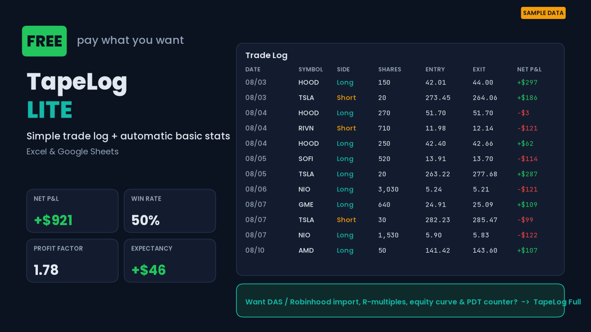

# TapeLog Lite: Free Trading Journal Template (Excel & Google Sheets)

A free day-trading journal spreadsheet. Log one round-trip trade per row and it calculates **net P&L after fees, win rate, average win/loss, profit factor, expectancy, largest win/loss and running P&L**. No macros and no sign-up. Works in Excel 2010+, Google Sheets and LibreOffice Calc.

## Download
- Direct page: https://tapelog-journal.github.io/tapelog-free-trading-journal/
- [`TapeLog-LITE-free.xlsx`](TapeLog-LITE-free.xlsx). Google Sheets: Drive → New → File upload → Open with Google Sheets.
- Or on Gumroad (pay what you want): https://tapelog.gumroad.com/l/welus

## Sample broker exports
`sample-exports/` holds fictional example files in the **DAS Trader Pro Trades window** and **Robinhood Account activity** CSV formats, for testing your own parser or the full TapeLog importer.

## Formulas used
- Win rate = winners ÷ total trades
- Profit factor = gross profit ÷ |gross loss|
- Expectancy = win% × avg win − loss% × avg loss

Step-by-step guide: https://tapelog-journal.github.io/tapelog/guides/how-to-calculate-win-rate-profit-factor-from-das-trader/

## Free trading calculators (in your browser)
- [Position size calculator](https://tapelog-journal.github.io/tapelog/tools/position-size-calculator/)
- [Risk/reward & R-multiple calculator](https://tapelog-journal.github.io/tapelog/tools/risk-reward-calculator/)
- [Profit factor & expectancy calculator](https://tapelog-journal.github.io/tapelog/tools/profit-factor-expectancy-calculator/)
- [Breakeven win rate calculator](https://tapelog-journal.github.io/tapelog/tools/win-rate-breakeven-calculator/)
- [Drawdown recovery calculator](https://tapelog-journal.github.io/tapelog/tools/drawdown-recovery-calculator/)
- [PDT day trades left calculator](https://tapelog-journal.github.io/tapelog/tools/pdt-day-trade-calculator/)

## Newsletter
One trading-stats lesson a week, free: **[subscribe to The TapeLog](https://thetapelog.beehiiv.com/subscribe)**

## Full version
[TapeLog Trading Journal ($24 one-time)](https://tapelog.gumroad.com/l/ewaacf) adds one-paste DAS Trader Pro / Robinhood import, R-multiples, max drawdown, equity curve, P&L by setup/hour/weekday/ticker, a PDT counter, and a Notion version. Website: https://tapelog-journal.github.io/tapelog/

## Disclaimer
Educational record-keeping tool, not financial advice. Sample data is fictional. Not affiliated with DAS Inc. or Robinhood Markets, Inc.

License: free to use for personal trading records; do not resell.
